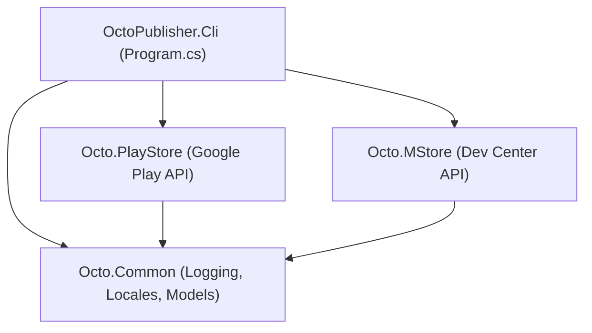

# OctoPublisher Architectural Codebase Map

> **Engine**: .NET 10 | **Role**: Multi-Store Application Publishing & Asset Distribution Engine | **CLI**: `octopublish`

---

## 1. Component Registry

### `src/OctoPublisher.Cli` (Entry Point & Commands)
- **`Program.cs`**: CLI command dispatcher (`sync`, `init`, `pull`, `inspect`, `test`, `playstore publish`, `mstore publish`).
  - *Key Contracts*: `HandlePlayStorePublishAsync`, `HandleMStorePublishAsync`, `HandleSyncAsync`. Auto-detects `packaging/store/{android,windows}` and `packaging/whatsnew`.
  - *SSOT*: Primary command router for store operations.
- **`Commands/PackagingInspector.cs`**: Inspects package integrity, manifests, and localization assets.
- **`Commands/PackagingPuller.cs`**: Pulls remote store metadata into local directories.
- **`Commands/PackagingScaffolder.cs`**: Generates initial store folder layouts (`packaging/`).
- **`Validation/MetadataLinter.cs`**: Validates character limits, mandatory files, and image specs before store upload.

### `src/Octo.PlayStore` (Google Play Engine)
- **`PlayStorePublisher.cs`**: Orchestrates Google Play submission (AAB upload, track assignment, store listings, icons, screenshots).
  - *Key Method*: `PublishAsync(...)`.
- **`Client/PlayStoreClient.cs`**: Low-level Google Play Developer API v3 HTTP client (edits, bundles, listings, images, commits).
- **`Metadata/PlayStoreListingManager.cs`**: Resolves localized descriptions, release notes, and store graphic assets.
- **`Services/GoogleAuthService.cs`**: Handles Google Cloud Service Account OAuth2 JWT minting and bearer token caching.

### `src/Octo.MStore` (Microsoft Partner Center Engine)
- **`Client/MStoreClient.cs`**: Microsoft Dev Center submission API client (create submission, commit, cancel, status poll).
- **`Client/MStoreCatalogClient.cs`**: Store front-end catalog query client.
- **`Auth/MStoreTokenService.cs`**: Azure AD / Entra ID OAuth2 client-credential token provider.
- **`Storage/AzureBlobUploader.cs`**: Block blob streaming uploader for large MSIX packages.
- **`Metadata/MStoreListingManager.cs`**: Resolves localized Windows store descriptions, release notes, and icon assets.
- **`Models/MStoreCredentials.cs`**: Credentials loader (`Load(...)`) with local JSON fallback and environment variable resolution.

### `src/Octo.Common` (Shared Utilities)
- **`Logging/AnsiTerminal.cs`**: Colorized terminal output with ANSI stripping support.
- **`Graphics/ImageTemplateGenerator.cs`**: Generates placeholder icons and banners with embedded CRC calculations.
- **`Metadata/LocaleRegistry.cs`**: Normalizes BCP-47 and store-specific locale codes (e.g. `ru` -> `ru-RU`).
- **`Models/PublisherResult.cs`**: Standard exit code and message envelope for all operations.

---

## 2. Dependency Graph

