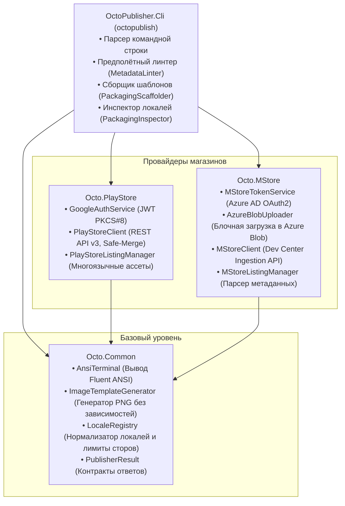

# Архитектура движка OctoPublisher

OctoPublisher спроектирован по принципам модульности, высокой производительности и нулевых сторонних нативных зависимостей.

---

## Архитектурные слои

---

## Ключевые компоненты

### 1. `ImageTemplateGenerator` (`Octo.Common`)
- Генерирует валидные файлы PNG с заголовком IHDR, сжатым потоком IDAT (`System.IO.Compression.ZLibStream`) и чанком IEND.
- Читает размеры PNG и JPEG файлов по их заголовкам без накладных расходов на полное декодирование растра.
- Полностью кроссплатформенный и работает без `System.Drawing`, `SkiaSharp` или нативных графических библиотек.

### 2. Механизм `Safe-Merge` (`Octo.PlayStore`)
- Защищает от стирания заголовков при обновлении листинга в Google Play API.
- Выполняет `GET` перед `PUT`, восстанавливая исходные значения для пропущенных полей.

### 3. Блочный загрузчик Azure Blob (`Octo.MStore`)
- Реализует параллельную передачу чанков пакетов `.msix` / `.zip` в блочное хранилище Azure по SAS-ссылке Partner Center.
- Отображает интерактивный прогресс-бар в консоли с расчетом скорости передачи данных.

### 4. Клиент Display Catalog API (`Octo.MStore`)
- Выполняет обратный импорт метаданных и графики из Microsoft Store (`displaycatalog.mp.microsoft.com`).
- Автоматически находит баннеры SuperHeroArt (1920x1080), логотипы 300x300 и скриншоты в исходном разрешении без необходимости ввода ключей Azure AD.
